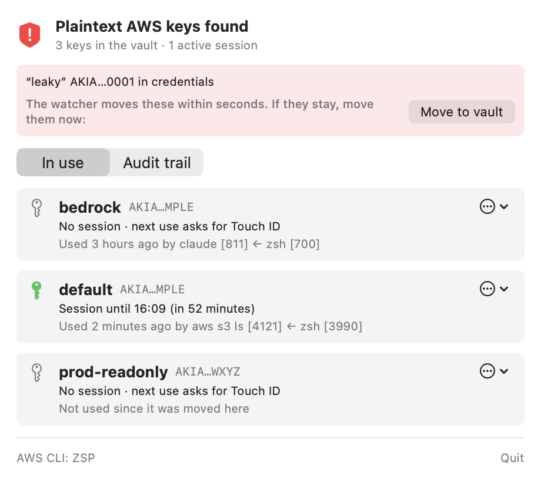
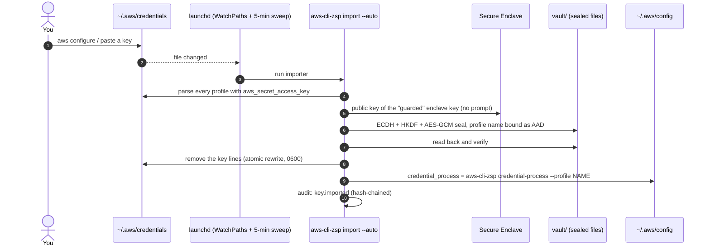
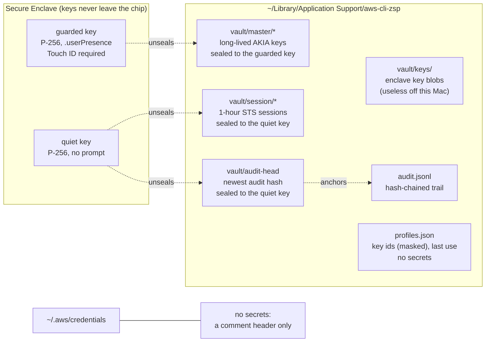
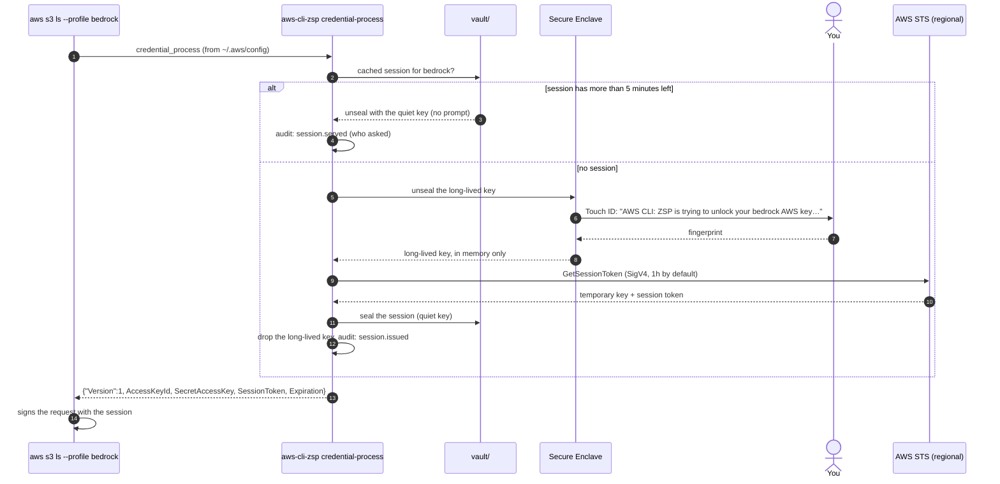
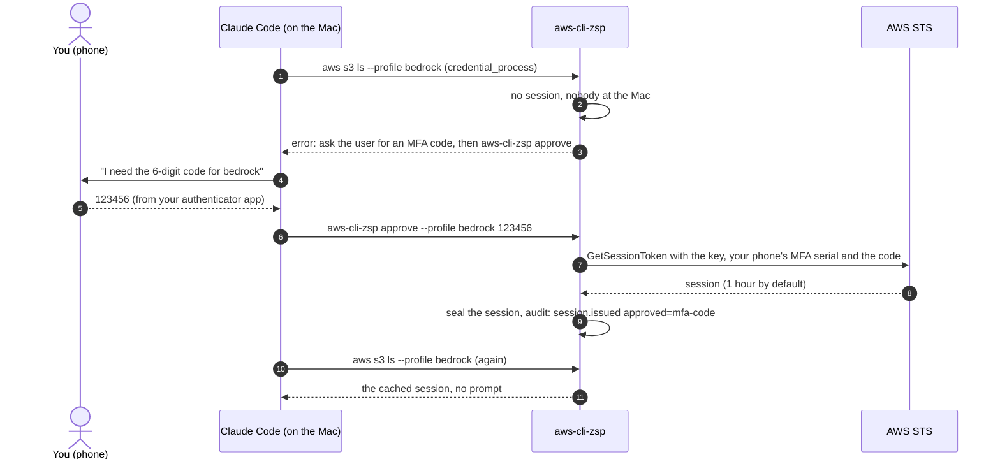

# aws-cli-zsp (AWS CLI: ZSP)

**Zero Standing Permissions (ZSP) for AWS keys on macOS.** It removes the plaintext keys from
`~/.aws` and asks you to authenticate (Touch ID) before a key is used. One approval gives the
CLI a session that is reused without asking until it expires (1 hour by default), so nothing on
your Mac holds standing AWS access: there is no readable key to steal, and every session ends
on its own. Your access keys are sealed by the Mac's
Secure Enclave, the chip will not unseal one without Touch ID, the AWS CLI and SDKs only ever
see a session that lasts an hour, and any key that lands in `~/.aws/credentials` (from
`aws configure`, a paste, a script) is moved out within seconds.

It is built from scratch on the ideas behind [aws-vault](https://github.com/ByteNess/aws-vault),
and adds:

| | aws-vault | aws-cli-zsp |
|---|---|---|
| No plaintext keys on disk, STS sessions to the CLI | ✅ Keychain | ✅ Secure Enclave, Touch ID enforced by the chip |
| Keys written to `~/.aws` are moved automatically | ❌ | ✅ launchd watcher plus a 5-minute sweep |
| Touch ID before a long-lived key is used | optional | always |
| Audit trail | ❌ | hash-chained, with who asked (`aws s3 ls ← zsh`) |
| Rotate a key | `aws-vault rotate` | one click, verified before the old key is deleted |
| Revoke sessions already issued (a thief's too) | ❌ | one click (an `aws:TokenIssueTime` deny policy) |
| MFA enforced by AWS, not just asked for locally | `mfa_serial`, a code typed each session | this Mac is an MFA device (one Touch ID), and AWS refuses the bare key |
| Approve when you are not at the Mac (Claude Code Remote Control) | ❌ | a code from your phone: `aws-cli-zsp approve` |
| When AWS last saw each key used | ❌ | **Check last use in AWS** |
| Menu bar UI | ❌ | ✅ |
| Works with plain `aws` and every SDK, no wrapper | `exec` or `credential_process` | `credential_process`, wired for you |

## What it looks like

| Touch ID before a key is used | Keys, sessions and who used them | Hash-chained audit trail |
|---|---|---|
|  |  |  |

A key written to `~/.aws/credentials` turns the shield red until the watcher has moved it
(seconds), with a button to move it at once:



The panel lives in the menu bar (the shield). If a crowded menu bar hides it behind the notch,
open **aws-cli-zsp** from Spotlight or run `aws-cli-zsp ui` to get the same panel in a window.

## Install

```bash
bash scripts/build-app.sh             # tests, build, sign, copy to ~/Applications (changes nothing in ~/.aws)
bash scripts/build-app.sh --install   # the same, then `aws-cli-zsp install`
```

`aws-cli-zsp install`:
1. links `~/.local/bin/aws-cli-zsp`
2. loads `consulting.cloudscale.zsp.watch`, which runs `aws-cli-zsp import --auto` whenever
   either AWS file changes, and every 5 minutes
3. starts the menu bar app at login
4. moves every plaintext key into the vault and adds
   `credential_process = …/aws-cli-zsp credential-process --profile NAME` to `~/.aws/config`

From then on, `aws --profile bedrock s3 ls` works as before. The first command each hour shows
"AWS CLI: ZSP is trying to unlock your “bedrock” AWS key for a 1-hour session, for aws s3 ls";
the rest reuse the cached session.

**Upgrading from 0.1.x** (which stored keys as plain Keychain items): run `aws-cli-zsp migrate`
once. macOS asks for your login password once per key, because those items were bound to the
exact build that made them. After that, updates never ask for anything but Touch ID.

## How it works

### 1. Intercepting keys written to `~/.aws`

Anything that writes a key (`aws configure`, a paste, an installer script) triggers launchd,
which runs the importer. The key is sealed and read back before the file is touched, and the
profile is pointed at aws-cli-zsp instead.



### 2. Where the keys are stored



Nothing secret is in a plain file, the Keychain or memory longer than one STS call. Copying
the folder to another machine gets you nothing: the enclave keys only work inside this Mac's chip.

### 3. How the AWS CLI gets credentials back

The AWS CLI and every SDK support `credential_process`: they run a command and read JSON
credentials from it. aws-cli-zsp is that command, so nothing needs a wrapper.



The CLI only ever holds a session. A leaked session expires on its own, cannot call IAM to
mint a new key, and **Revoke sessions** kills every one issued so far.

### Details

- **Touch ID enforced by hardware.** Each key is encrypted (P-256 ECDH, HKDF-SHA256, AES-GCM,
  bound to its profile name) to a Secure Enclave key created with `.userPresence`. The enclave
  will not decrypt until you approve, whichever program asks, and the sealed files are useless
  on any other Mac. Moving a key in needs only the public key, so it never prompts. Sessions
  and the audit anchor use a second enclave key that needs no prompt.
- **Named dialogs.** The command is a helper app inside the bundle, so every prompt says
  "AWS CLI: ZSP".
- **Why not Keychain items.** macOS binds an item made by a binary with no Apple Team ID to that
  build's exact code hash. 0.1.0 used them, and every update showed a login-password dialog,
  with no Touch ID, for the app's own keys.
- **Sessions, not keys.** The CLI gets `GetSessionToken` credentials from the regional STS
  endpoint, which are valid in opt-in regions such as af-south-1. A leaked session expires on
  its own and cannot call IAM to mint a new key.
- **Fail closed.** A key leaves a file only after its sealed copy has been written and read
  back. If the audit entry can't be written, no credentials are issued.
- **Audit chain.** `~/Library/Application Support/aws-cli-zsp/audit.jsonl`: every entry hashes
  the one before it, and the newest hash is sealed separately, so editing, deleting or
  truncating the file fails `aws-cli-zsp audit --verify`.

## MFA, and approving from your phone

Touch ID protects the key on this Mac, but AWS does not know about it: a copy of the key
would work anywhere. Two commands make AWS itself demand MFA, without adding a step locally:

```bash
aws-cli-zsp mfa setup   --profile bedrock   # this Mac becomes a virtual MFA device for the key's IAM user
aws-cli-zsp mfa enforce --profile bedrock   # AWS denies everything the key does without MFA
```

`mfa setup` creates a virtual MFA device in IAM and seals its seed with the key, so every
session the Mac issues carries MFA and still costs one Touch ID. `mfa enforce` attaches an
inline policy (`aws-cli-zsp-require-mfa`) that denies every action except `GetSessionToken`
and `GetCallerIdentity` when `aws:MultiFactorAuthPresent` is false. Because MFA sessions may
call IAM, a second statement requires MFA from the last 5 minutes for creating keys, MFA
devices or policies: aws-cli-zsp's own admin calls use a fresh session, while a leaked
hour-long CLI session cannot mint itself a permanent key. It refuses to run until an MFA
session from this Mac has worked, so it cannot lock you out.

**When nobody is at the Mac** (Claude Code driven over Remote Control from your phone, or the
screen locked), a Touch ID prompt would wait where nobody can see it. Instead, when the screen
is locked or the Mac has had no keyboard or mouse input for 5 minutes, a new session fails at
once with what to do. With remote approval enabled, a code from your phone's authenticator
approves it:

```bash
aws-cli-zsp remote enable --profile bedrock    # once, at the Mac: needs mfa enforce and an MFA device on your phone
aws-cli-zsp approve --profile bedrock 123456   # what Claude Code runs after asking you for the code
```



Why this is safe: approval by code needs a copy of the key that opens without Touch ID
(sealed to the enclave's no-prompt key, so still useless off this Mac). That copy has no MFA
seed, and `remote enable` refuses to make it until `mfa enforce` has run. So a program that
reads it gets a key AWS refuses without a code from your phone, which it does not have. The
code AWS sees once and rejects on reuse; it is in your chat for 30 seconds of usefulness.

The IAM user needs `iam:CreateVirtualMFADevice`, `iam:EnableMFADevice`, `iam:ListMFADevices`
and `iam:PutUserPolicy` on itself for these commands.

## Commands

```
aws-cli-zsp list                              keys in the vault, sessions, last use and by whom
aws-cli-zsp scan                              plaintext keys left in ~/.aws (exit 1 if any)
aws-cli-zsp add --profile P                   type a key in, secret hidden; it never touches a file
aws-cli-zsp inspect --profile P               ARN, and when AWS last saw each key used
aws-cli-zsp rotate --profile P [--keep-old]   new key, verified, then the old one deleted (or deactivated)
aws-cli-zsp revoke-sessions --profile P       deny every session issued before now
aws-cli-zsp clear-sessions [--profile P]      drop cached sessions here (the next command needs Touch ID)
aws-cli-zsp duration --profile P 8h           session length, 15m to 12h (default 1h)
aws-cli-zsp exec --profile P -- terraform plan
aws-cli-zsp disable-key | delete-key | forget --profile P
aws-cli-zsp mfa setup | enforce --profile P
aws-cli-zsp remote enable [--serial ARN] | disable --profile P
aws-cli-zsp approve --profile P CODE
aws-cli-zsp audit [--verify] [--limit N]
aws-cli-zsp migrate                           move 0.1.x Keychain items into the vault
aws-cli-zsp check-touch-id                    show the Touch ID prompt, unlock nothing
aws-cli-zsp ui                                open the panel in a window
aws-cli-zsp uninstall [--restore-plaintext]
```

`--json` on any command prints a machine-readable result, which is what the menu bar app uses.

## Limits

- Malware running as you can run aws-cli-zsp too. It gets a cached session without a prompt
  until that session expires, the same trade-off aws-vault makes; `clear-sessions` or a
  shorter `duration` narrows the window. It cannot get the long-lived key without your finger.
- The enclave's public key is not secret, so a program running as you could seal a key of its
  own in place of yours, and could rewrite the audit log and its anchor together. **Inspect**
  shows the ARN a profile really belongs to.
- Rotate, revoke and disable call IAM with the profile's own key, so the IAM user needs
  `iam:ListAccessKeys`, `iam:CreateAccessKey`, `iam:DeleteAccessKey`, `iam:UpdateAccessKey`,
  `iam:GetAccessKeyLastUsed` and `iam:PutUserPolicy` on itself.
- Profiles with `mfa_serial` and `role_arn` (AssumeRole with MFA) are not handled by
  aws-cli-zsp yet; its own MFA covers the key's direct use. See PLAN.md.
- Away detection is a heuristic: 5 minutes without input (`ZSP_AWAY_AFTER`) or a locked
  screen. Sitting still and reading counts as away; touch the trackpad and retry.

## Development

```bash
swift test                               # 38 tests, including the real Secure Enclave (no-prompt tier)
ZSP_NETWORK_TESTS=1 swift test           # adds a real STS call with a fake key (expects InvalidClientTokenId)
```

To try it without touching your real setup, point it at a sandbox with
`AWS_SHARED_CREDENTIALS_FILE`, `AWS_CONFIG_FILE` and `ZSP_HOME`.
`ZSPMenu --snapshot out.png [--audit]` renders the panel to a file (the screenshots above are
made that way, from a sandbox holding AWS's documented example keys). The app icon is drawn by
`swift scripts/make-icon.swift`.

## License

MIT. See [LICENSE](LICENSE).
