# aws-cli-zsp (AWS CLI: ZSP)

**Zero Standing Permissions (ZSP) for AWS keys on macOS.** It removes the plaintext keys from
`~/.aws` and asks you to authenticate (Touch ID) before a key is used. One approval gives the
CLI a session that is reused without asking until it expires (1 hour by default), so nothing on
your Mac holds standing AWS access: there is no readable key to steal, and every session ends
on its own. Your access keys are sealed by the Mac's
Secure Enclave, the chip will not unseal one without Touch ID, the AWS CLI and SDKs only ever
see a session that lasts an hour, and any key that lands in `~/.aws/credentials` (from
`aws configure`, a paste, a script) is moved out within seconds.

## The problem

This is what any program running as you can read on a normal Mac with the AWS CLI set up
(keys redacted here; on the real screen they were in full):

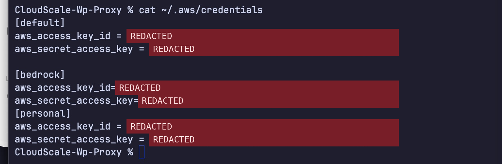

Every key there is a standing permission: it works from anywhere, forever, for whoever copies
it. After aws-cli-zsp the same file holds no keys at all, and the AWS CLI still works.

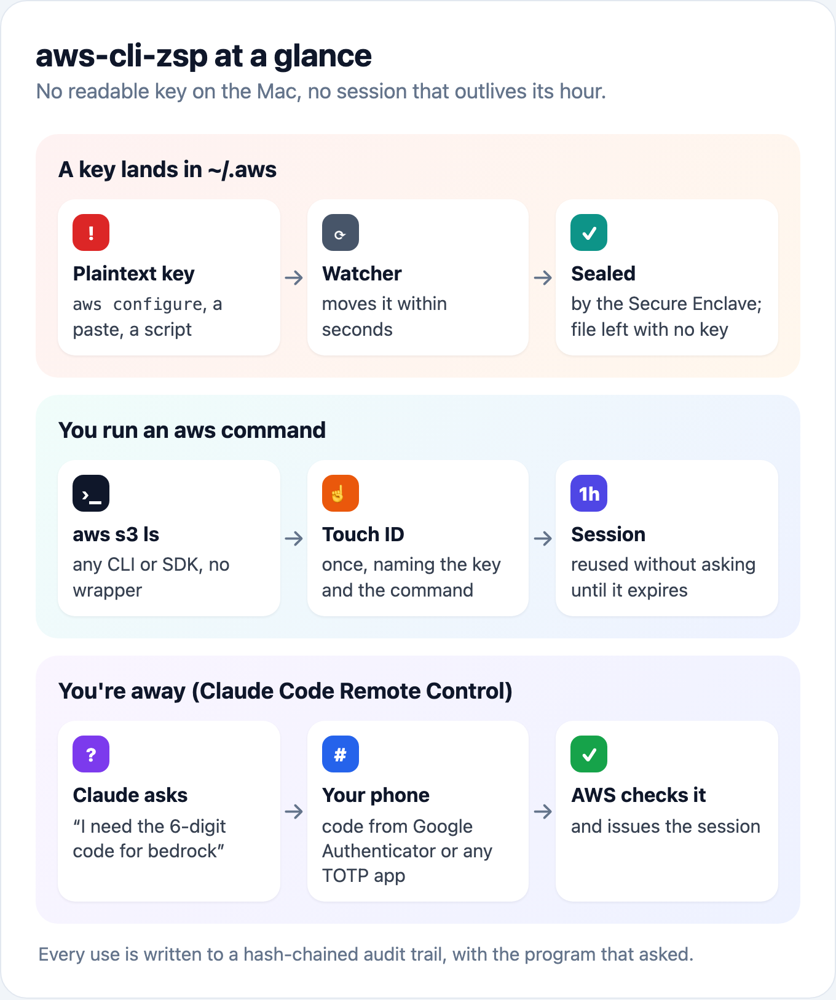

It is built from scratch on the ideas behind [aws-vault](https://github.com/ByteNess/aws-vault),
and adds:

| | aws-vault | aws-cli-zsp |
|---|---|---|
| No plaintext keys on disk, STS sessions to the CLI | ✅ Keychain | ✅ Secure Enclave, Touch ID enforced by the chip |
| Keys written to `~/.aws` are moved automatically | ❌ | ✅ launchd watcher plus a 5-minute sweep |
| Touch ID before a long-lived key is used | optional | always |
| Audit trail | ❌ | hash-chained, with who asked (`aws s3 ls ← zsh`) |
| Rotate a key | `aws-vault rotate` | one click, verified before the old key is deleted |
| Revoke sessions already issued (a thief's too) | ❌ | one click (an `aws:TokenIssueTime` deny policy) |
| MFA enforced by AWS, not just asked for locally | `mfa_serial`, a code typed each session | this Mac is an MFA device (one Touch ID), and AWS refuses the bare key; set up and undone from the UI |
| Approve when you are not at the Mac (Claude Code Remote Control) | ❌ | a code from your phone: `aws-cli-zsp approve` |
| When AWS last saw each key used | ❌ | **Check last use in AWS** |
| Menu bar UI | ❌ | ✅ |
| Works with plain `aws` and every SDK, no wrapper | `exec` or `credential_process` | `credential_process`, wired for you |

## What it looks like

**Overview:** status, health checks and tests

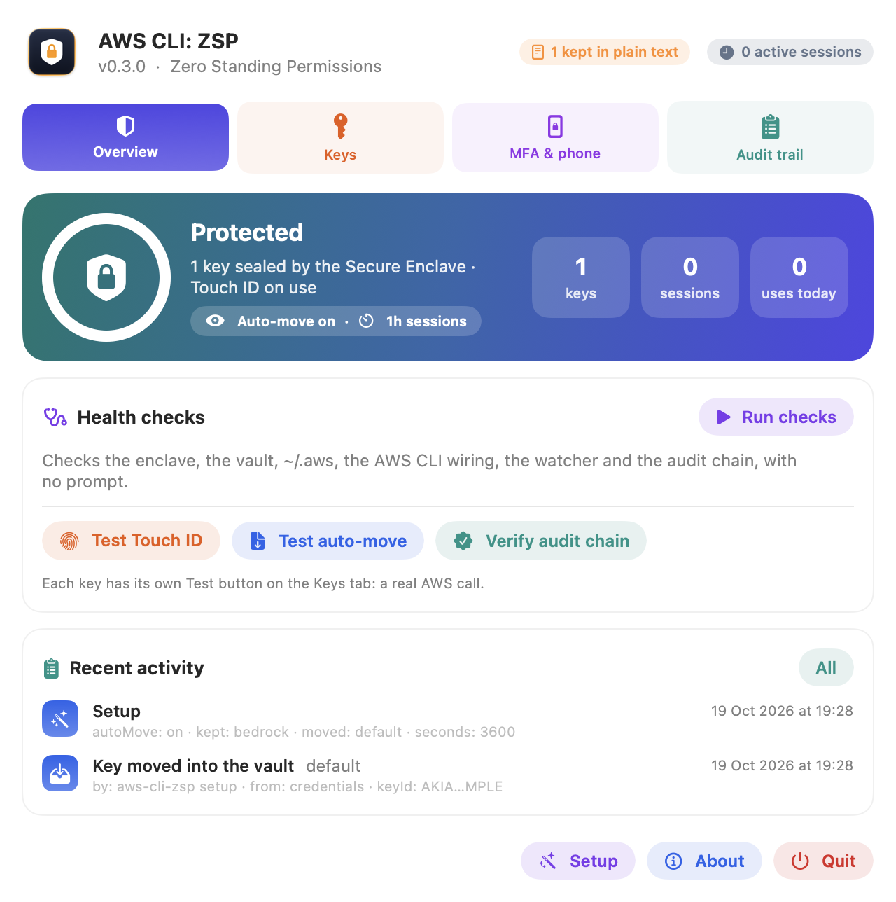

**Keys:** test, check in AWS, rotate, revoke

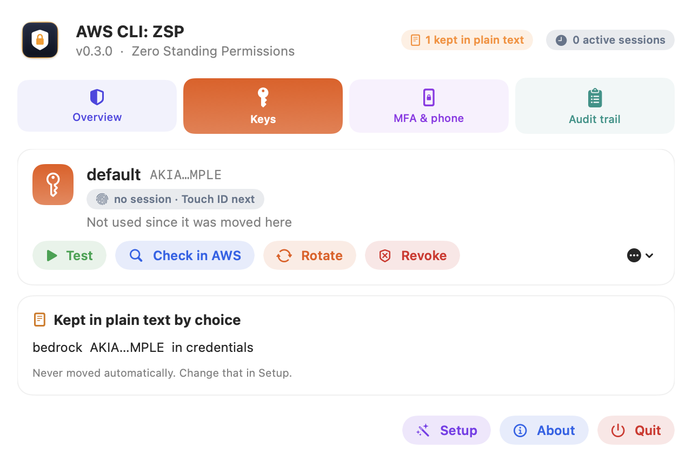

**Onboarding:** pick which keys move, and whether new keys move automatically

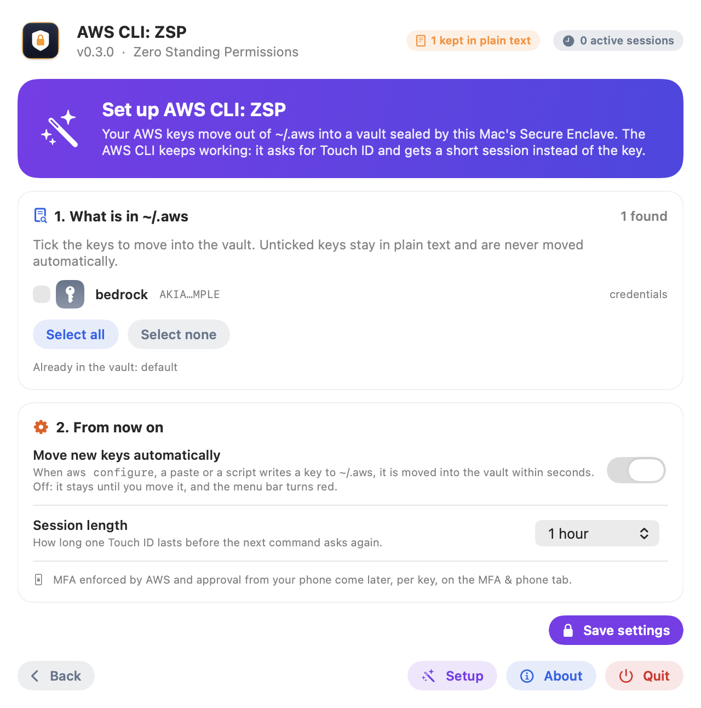

**Health checks**

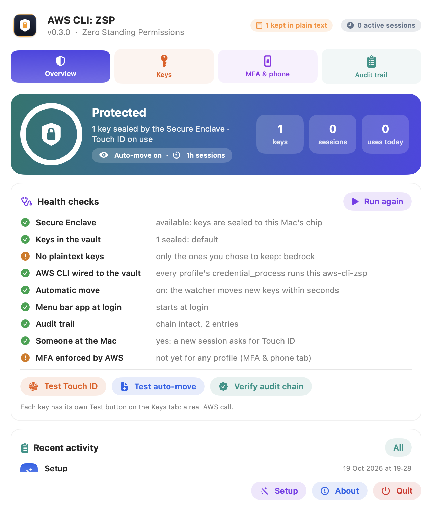

**Touch ID before a key is used**

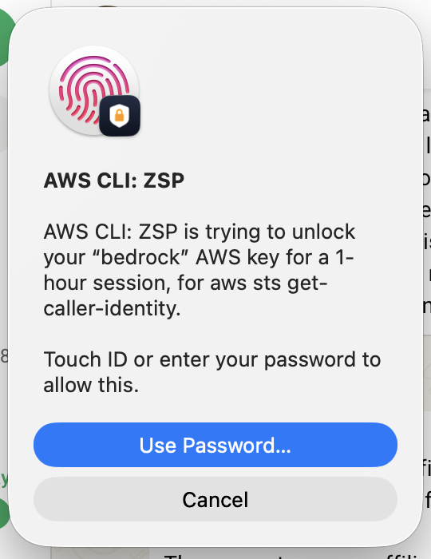

The **MFA & phone** tab is shown in [MFA, and approving from your phone](#mfa-and-approving-from-your-phone).

Every step in this README has a button: **Setup** in the footer re-runs onboarding, **Run
checks** is `aws-cli-zsp doctor`, **Test Touch ID** / **Test auto-move** / **Verify audit
chain** exercise each part without touching your keys, and each key's **Test** makes a real
AWS call with it. The audit trail tab shows every use, with the program that asked.

The panel lives in the menu bar (the shield). If a crowded menu bar hides it behind the notch,
open **aws-cli-zsp** from Spotlight or run `aws-cli-zsp ui` to get the same panel in a window.

## Install

```bash
bash scripts/build-app.sh             # tests, build, sign, copy to ~/Applications (changes nothing in ~/.aws)
bash scripts/build-app.sh --install   # the same, then `aws-cli-zsp install`
```

`aws-cli-zsp install`:
1. links `~/.local/bin/aws-cli-zsp`
2. loads `consulting.cloudscale.zsp.watch`, which runs `aws-cli-zsp import --auto` whenever
   either AWS file changes, and every 5 minutes
3. starts the menu bar app at login, which opens **Setup** the first time: it lists the keys
   in `~/.aws`, you tick the ones to move, and choose whether keys written later move
   automatically (the watcher does nothing until you have chosen) and how long a session lasts
4. for each key moved, adds `credential_process = …/aws-cli-zsp credential-process --profile NAME`
   to `~/.aws/config`

Without the UI: `aws-cli-zsp setup --move default,bedrock --keep personal --auto on --duration 1h`.
Unticked keys stay in plain text and are never moved automatically.

From then on, `aws --profile bedrock s3 ls` works as before. The first command each hour shows
"AWS CLI: ZSP is trying to unlock your “bedrock” AWS key for a 1-hour session, for aws s3 ls";
the rest reuse the cached session.

**Upgrading from 0.1.x** (which stored keys as plain Keychain items): run `aws-cli-zsp migrate`
once. macOS asks for your login password once per key, because those items were bound to the
exact build that made them. After that, updates never ask for anything but Touch ID.

## How it works

### 1. Intercepting keys written to `~/.aws`

Anything that writes a key (`aws configure`, a paste, an installer script) triggers launchd,
which runs the importer. The key is sealed and read back before the file is touched, and the
profile is pointed at aws-cli-zsp instead.

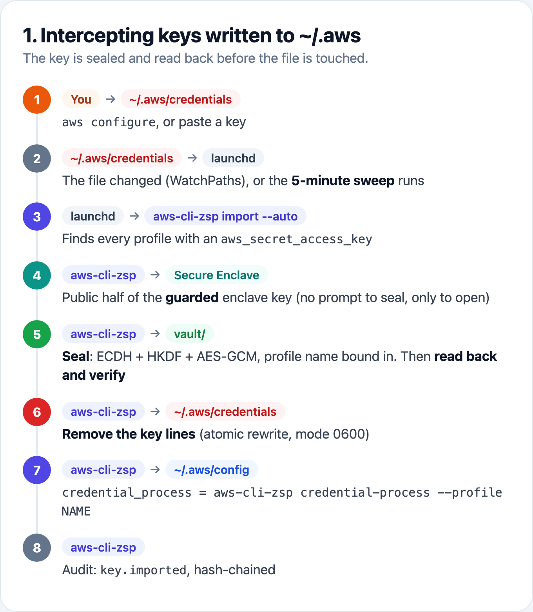

### 2. Where the keys are stored

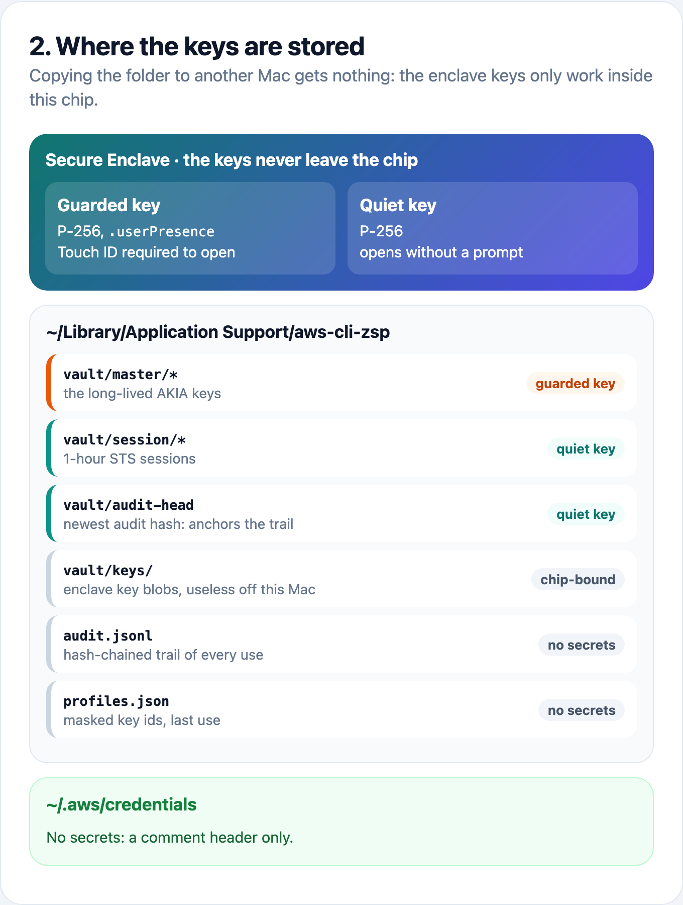

Nothing secret is in a plain file, the Keychain or memory longer than one STS call. Copying
the folder to another machine gets you nothing: the enclave keys only work inside this Mac's chip.

### 3. How the AWS CLI gets credentials back

The AWS CLI and every SDK support `credential_process`: they run a command and read JSON
credentials from it. aws-cli-zsp is that command, so nothing needs a wrapper.

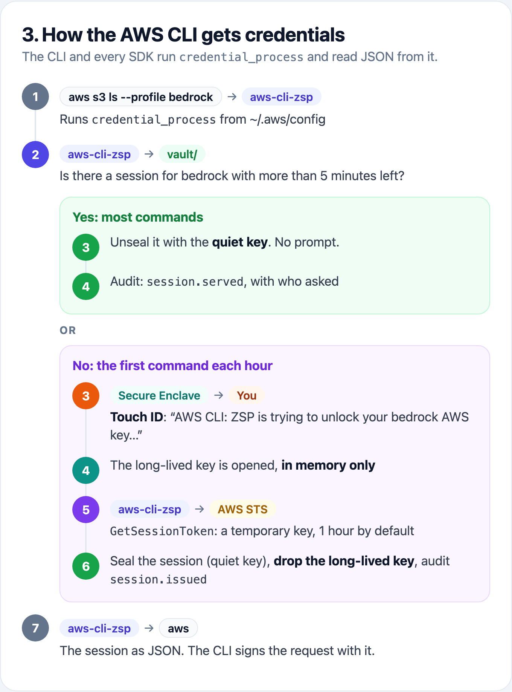

The CLI only ever holds a session. A leaked session expires on its own, cannot call IAM to
mint a new key, and **Revoke sessions** kills every one issued so far.

### Details

- **Touch ID enforced by hardware.** Each key is encrypted (P-256 ECDH, HKDF-SHA256, AES-GCM,
  bound to its profile name) to a Secure Enclave key created with `.userPresence`. The enclave
  will not decrypt until you approve, whichever program asks, and the sealed files are useless
  on any other Mac. Moving a key in needs only the public key, so it never prompts. Sessions
  and the audit anchor use a second enclave key that needs no prompt.
- **Named dialogs.** The command is a helper app inside the bundle, so every prompt says
  "AWS CLI: ZSP".
- **Why not Keychain items.** macOS binds an item made by a binary with no Apple Team ID to that
  build's exact code hash. 0.1.0 used them, and every update showed a login-password dialog,
  with no Touch ID, for the app's own keys.
- **Sessions, not keys.** The CLI gets `GetSessionToken` credentials from the regional STS
  endpoint, which are valid in opt-in regions such as af-south-1. A leaked session expires on
  its own and cannot call IAM to mint a new key.
- **Fail closed.** A key leaves a file only after its sealed copy has been written and read
  back. If the audit entry can't be written, no credentials are issued.
- **Audit chain.** `~/Library/Application Support/aws-cli-zsp/audit.jsonl`: every entry hashes
  the one before it, and the newest hash is sealed separately, so editing, deleting or
  truncating the file fails `aws-cli-zsp audit --verify`.

## MFA, and approving from your phone

Touch ID protects the key on this Mac, but AWS does not know about it: a copy of the key
would work anywhere. The **MFA & phone** tab walks through three steps per key, each a button, and each finished
step has an undo link under it (**Remove MFA**, **Stop requiring MFA**, **Turn off phone
approval**) in case something that uses the key stops working:

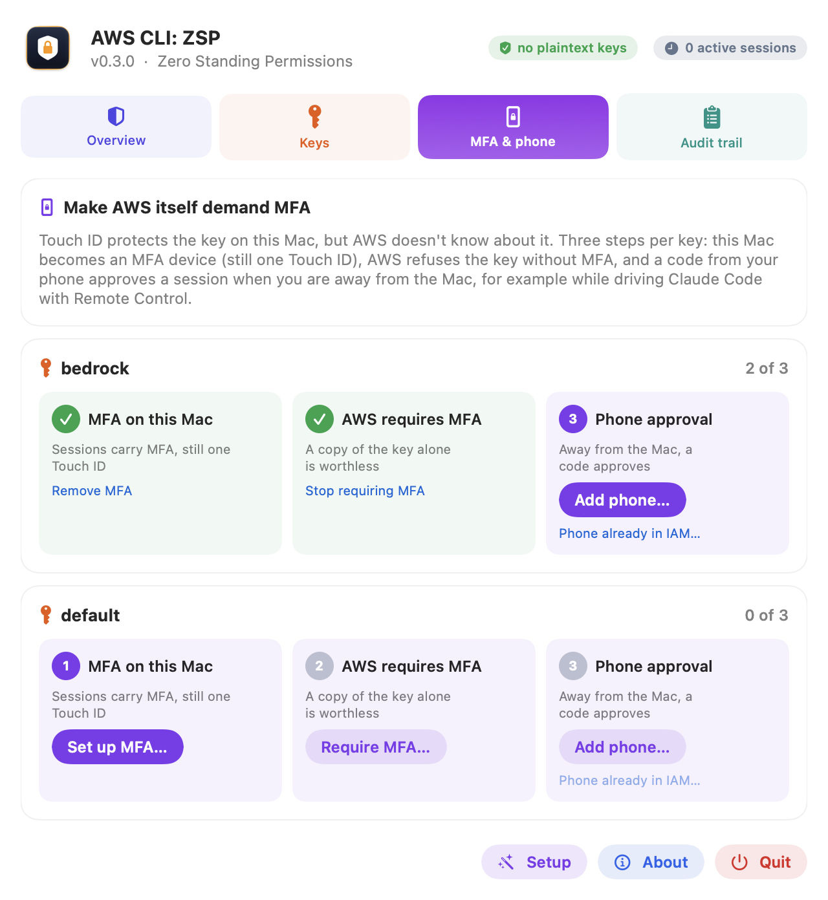

The same steps as commands make AWS itself demand MFA, without adding a step locally:

```bash
aws-cli-zsp mfa setup   --profile bedrock   # this Mac becomes a virtual MFA device for the key's IAM user
aws-cli-zsp mfa enforce --profile bedrock   # AWS denies everything the key does without MFA
```

`mfa setup` creates a virtual MFA device in IAM and seals its seed with the key, so every
session the Mac issues carries MFA and still costs one Touch ID. `mfa enforce` attaches an
inline policy (`aws-cli-zsp-require-mfa`) that denies every action except `GetSessionToken`
and `GetCallerIdentity` when `aws:MultiFactorAuthPresent` is false. Because MFA sessions may
call IAM, a second statement requires MFA from the last 5 minutes for creating keys, MFA
devices or policies: aws-cli-zsp's own admin calls use a fresh session, while a leaked
hour-long CLI session cannot mint itself a permanent key. It refuses to run until an MFA
session from this Mac has worked, so it cannot lock you out.

To undo: `aws-cli-zsp mfa unenforce --profile bedrock` removes the policy (the key works
without MFA again, everywhere); `aws-cli-zsp mfa remove --profile bedrock` undoes everything,
removing the policy first while this Mac can still give MFA, then deactivating and deleting
its MFA device. If the Mac cannot get an MFA session any more (its device deleted in the
console), AWS refuses both, and the fix is to delete the inline policy `aws-cli-zsp-require-mfa`
in the IAM console.

**When nobody is at the Mac** (Claude Code driven over Remote Control from your phone, or the
screen locked), a Touch ID prompt would wait where nobody can see it. Instead, when the screen
is locked or the Mac has had no keyboard or mouse input for 5 minutes, a new session fails at
once with what to do. With remote approval enabled, a code from your phone's authenticator
approves it:

```bash
aws-cli-zsp mfa add-phone --profile bedrock    # once, at the Mac: a QR code for your authenticator app
aws-cli-zsp mfa confirm-phone --profile bedrock --serial ARN 123456 654321   # two codes in a row: enabled, approval on
aws-cli-zsp approve --profile bedrock 123456   # what Claude Code runs after asking you for the code
```

In the UI, **Add phone…** on step 3 does the first two: it creates the device in AWS, shows
its QR code, and asks for two codes.

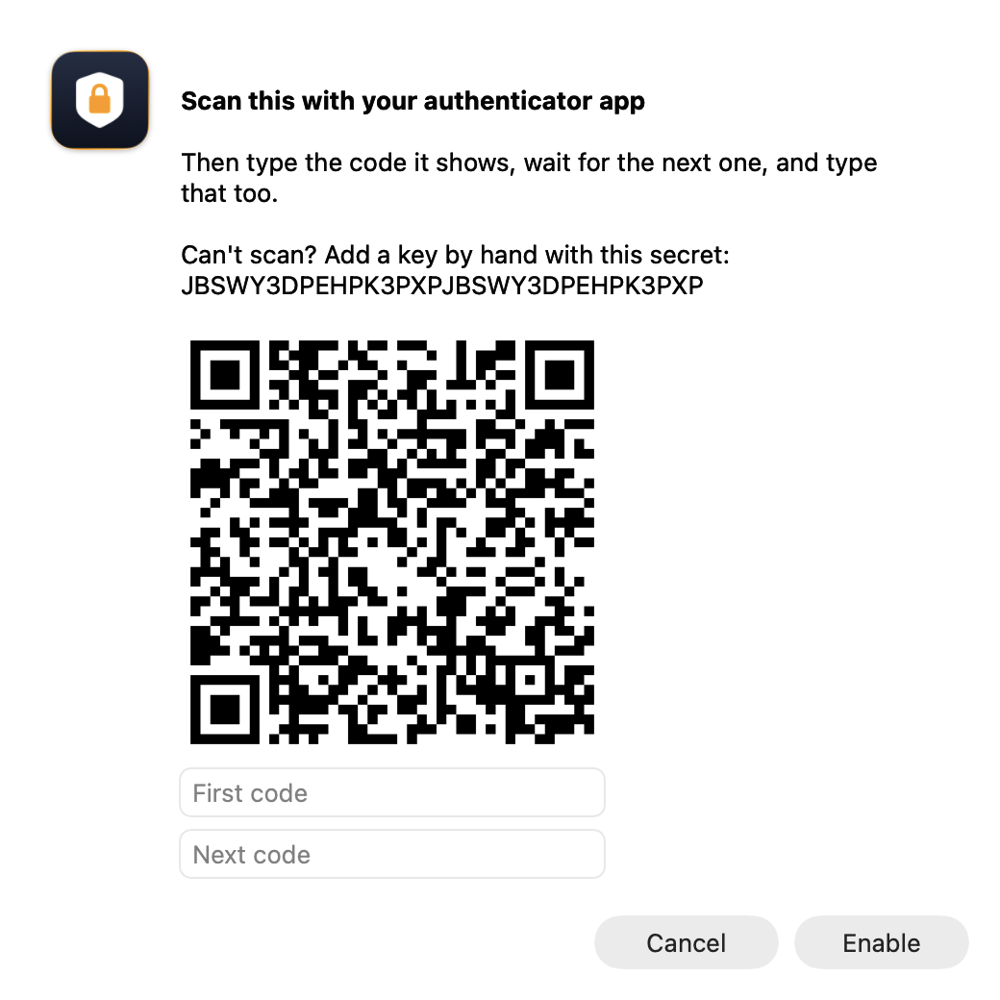

 Any TOTP app works: Google Authenticator, Microsoft
Authenticator, 1Password, Authy. There is no push approval: AWS IAM MFA is codes only, so you
read the code and send it. A phone you added in the IAM console already works too:
**Phone already in IAM…** (`aws-cli-zsp remote enable --profile bedrock`).

With Claude Code Remote Control, from your phone:

1. Ask Claude for something that needs AWS. Nobody is at the Mac, so instead of a Touch ID
   prompt nobody can see, the command fails at once, telling Claude to ask you for a code.
2. Claude asks: "I need the 6-digit code for bedrock."
3. Copy the code from your authenticator app and send it in the chat.
4. Claude runs `aws-cli-zsp approve`, AWS checks the code, and the session lasts the usual
   hour: nothing asks again until it expires.

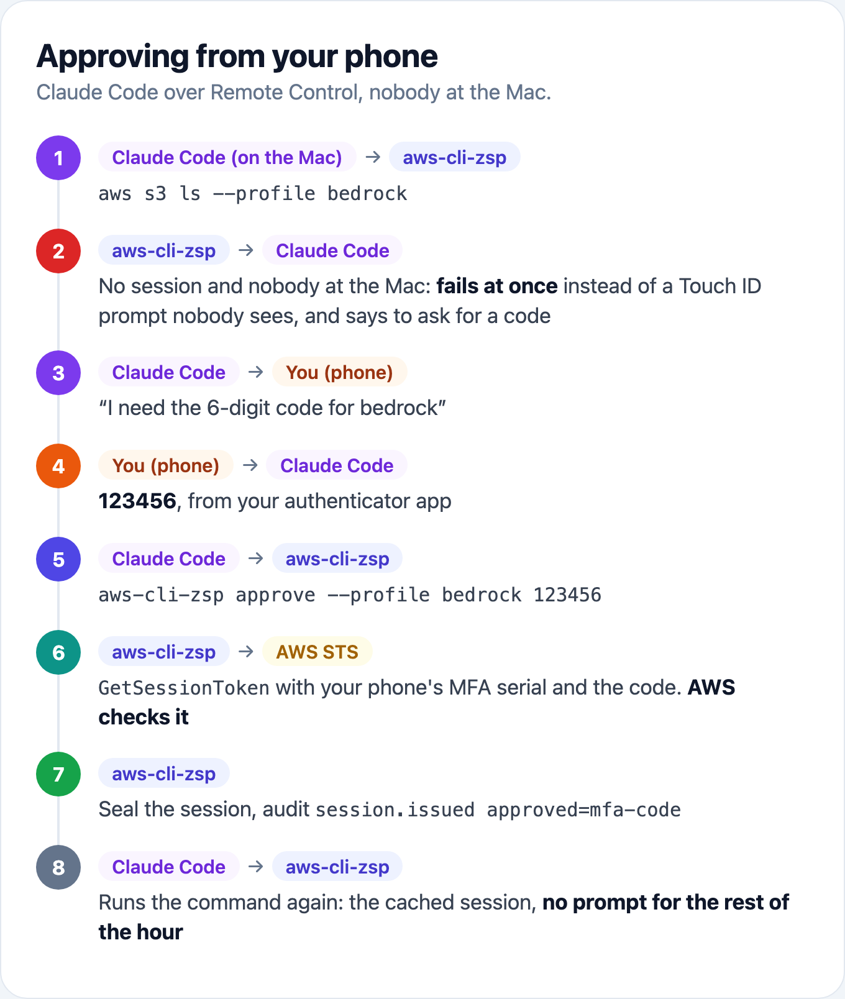

Why this is safe: approval by code needs a copy of the key that opens without Touch ID
(sealed to the enclave's no-prompt key, so still useless off this Mac). That copy has no MFA
seed, and `remote enable` refuses to make it until `mfa enforce` has run. So a program that
reads it gets a key AWS refuses without a code from your phone, which it does not have. The
code AWS sees once and rejects on reuse; it is in your chat for 30 seconds of usefulness.

The IAM user needs `iam:CreateVirtualMFADevice`, `iam:EnableMFADevice`, `iam:ListMFADevices`
and `iam:PutUserPolicy` on itself for these commands, and `iam:DeleteUserPolicy`,
`iam:DeactivateMFADevice` and `iam:DeleteVirtualMFADevice` to undo them.

## Commands

```
aws-cli-zsp setup [--move P,..] [--keep P,..] [--auto on|off] [--duration 1h]
                                              choose what moves and whether new keys move automatically
aws-cli-zsp doctor                            every check that must pass to be protected, no prompt
aws-cli-zsp test --profile P                  a real AWS call (GetCallerIdentity) with the key
aws-cli-zsp selftest-watcher                  write AWS's example key to ~/.aws and time the move
aws-cli-zsp list                              keys in the vault, sessions, last use and by whom
aws-cli-zsp scan                              plaintext keys left in ~/.aws (exit 1 if any)
aws-cli-zsp add --profile P                   type a key in, secret hidden; it never touches a file
aws-cli-zsp inspect --profile P               ARN, and when AWS last saw each key used
aws-cli-zsp rotate --profile P [--keep-old]   new key, verified, then the old one deleted (or deactivated)
aws-cli-zsp revoke-sessions --profile P       deny every session issued before now
aws-cli-zsp clear-sessions [--profile P]      drop cached sessions here (the next command needs Touch ID)
aws-cli-zsp duration --profile P 8h           session length, 15m to 12h (default 1h)
aws-cli-zsp exec --profile P -- terraform plan
aws-cli-zsp disable-key | delete-key | forget --profile P
aws-cli-zsp mfa setup | enforce --profile P
aws-cli-zsp mfa unenforce | remove --profile P   undo: MFA no longer required / this Mac's device deleted too
aws-cli-zsp mfa add-phone --profile P           QR code for Google Authenticator (or any TOTP app)
aws-cli-zsp mfa confirm-phone --profile P --serial ARN CODE1 CODE2
aws-cli-zsp mfa cancel-phone --profile P --serial ARN
aws-cli-zsp remote enable [--serial ARN] | disable --profile P
aws-cli-zsp approve --profile P CODE
aws-cli-zsp pin show | reset --profile P      the AWS account and user the profile is pinned to
aws-cli-zsp audit [--verify] [--limit N]
aws-cli-zsp migrate                           move 0.1.x Keychain items into the vault
aws-cli-zsp check-touch-id                    show the Touch ID prompt, unlock nothing
aws-cli-zsp ui                                open the panel in a window
aws-cli-zsp uninstall [--restore-plaintext]
```

`--json` on any command prints a machine-readable result, which is what the menu bar app uses.

## Limits

### What it protects against, and what it does not

| Threat | Protected? |
|---|---|
| A stolen laptop, backup, or a copy of `~/.aws` or the vault folder | ✅ nothing in them works off this Mac's chip |
| A script, package or tool that reads `~/.aws/credentials` | ✅ the file holds no keys |
| A program that wants your long-lived key | ✅ only the Secure Enclave can unseal it, and only after Touch ID |
| A key copied off the Mac some other way | ✅ with **MFA enforced**, AWS refuses it without a code |
| Malware running as you, **while a session is cached** | ⚠️ it can use that session until it expires (1 hour by default) |
| Malware running as you **swapping your key for its own** | ✅ refused: the profile is pinned to its AWS account |
| Malware running as you **planting a session of its own** | ✅ refused: only the session aws-cli-zsp issued is served |
| Malware running as you **rewiring `~/.aws/config`** to its own program | ⚠️ not prevented: **Run checks** shows it |
| Malware running as you **rewriting the audit trail** | ⚠️ not prevented: see below |

The ⚠️ rows come from one fact: malware running under your macOS user can do what you can
do without Touch ID.

- **It can use a cached session.** Reusing a session without asking is the point of a
  session, so anything running as you gets one too, until it expires; the same trade-off
  aws-vault makes. `clear-sessions`, a shorter `duration`, or **Revoke all sessions** narrow
  the window. It never gets the long-lived key.
- **Swapping your key is caught by account pinning.** Sealing a key into the vault needs
  only the Secure Enclave's *public* key, which is not secret (Touch ID opens a key, it is
  not needed to lock one). So malware cannot read your `bedrock` key, but it could store a
  key for *its own* AWS account under the name `bedrock`, and your commands would quietly
  run against the attacker's account (`aws s3 cp backup.zip s3://…` would upload to their
  bucket). To stop that, the first session for a profile records its AWS account and IAM
  user in the **login Keychain**, and every later session is checked against it (one
  GetCallerIdentity call per session, not per command). A key to another account or user
  gets nothing: the session is thrown away, `key.swapped` goes in the audit trail, and the
  error says what happened. Rotating the key, or re-importing a new key for the same user,
  passes.
  - *Why not just a hash?* Anything malware can write, it can re-hash: a hash in the vault
    folder or `profiles.json` would simply be recomputed for the attacker's key. The pin
    works because of *where* it lives: a login Keychain item trusts only the program that
    made it, so anything else changing or deleting it gets a macOS prompt.
  - The pin also records which session aws-cli-zsp issued, so a session written into the
    vault by something else is deleted, not served (`session.swapped`).
  - Changed the key to another account yourself? `aws-cli-zsp pin reset --profile P`
    (Touch ID). Deleting or forgetting a key removes its pin.
- **It can point `~/.aws/config` at a program of its own.** The `credential_process` line
  is a plain file; malware can change it so the AWS CLI asks something else for
  credentials. aws-cli-zsp is then not involved at all, so it cannot refuse anything.
  **Run checks** (and `aws-cli-zsp doctor`) shows any profile not wired to aws-cli-zsp.
- **It can rewrite the audit trail.** Each entry is hash-chained to the one before, and the
  newest hash is sealed in the vault, so editing or deleting entries by hand is caught by
  **Verify chain**. But that seal uses the no-prompt key (so sessions can be reused without
  Touch ID), so malware running as you can rewrite the whole log *and* re-seal its anchor,
  and Verify chain still says "intact". Treat the trail as a record of what happened, not
  as evidence against an attacker on this Mac; AWS CloudTrail is the record it cannot touch.

What would close the rest (see PLAN.md): sending the audit trail off the Mac (CloudWatch,
or S3 with Object Lock), and signing with an Apple Developer ID so the enclave keys can be
restricted to this app alone.

### Other limits

- Rotate, revoke and disable call IAM with the profile's own key, so the IAM user needs
  `iam:ListAccessKeys`, `iam:CreateAccessKey`, `iam:DeleteAccessKey`, `iam:UpdateAccessKey`,
  `iam:GetAccessKeyLastUsed` and `iam:PutUserPolicy` on itself.
- Profiles with `mfa_serial` and `role_arn` (AssumeRole with MFA) are not handled by
  aws-cli-zsp yet; its own MFA covers the key's direct use. See PLAN.md.
- Away detection is a heuristic: 5 minutes without input (`ZSP_AWAY_AFTER`) or a locked
  screen. Sitting still and reading counts as away; touch the trackpad and retry.

## Development

```bash
swift test                               # 44 tests, including the real Secure Enclave (no-prompt tier)
ZSP_NETWORK_TESTS=1 swift test           # adds a real STS call with a fake key (expects InvalidClientTokenId)
```

To try it without touching your real setup, point it at a sandbox with
`AWS_SHARED_CREDENTIALS_FILE`, `AWS_CONFIG_FILE` and `ZSP_HOME`.
`ZSPMenu --snapshot out.png [--keys|--mfa|--audit|--setup|--about|--checks|--qr]` renders the
panel to a file (the screenshots above are made that way, from a sandbox holding AWS's
documented example keys). The app icon is drawn by `swift scripts/make-icon.swift`. The
diagrams are HTML in `docs/diagrams/diagrams.html`, rendered to PNG by
`bash scripts/render-diagrams.sh` (needs Playwright; images rather than Mermaid because
GitHub's mobile app shows Mermaid as source).

## License

MIT. See [LICENSE](LICENSE).
