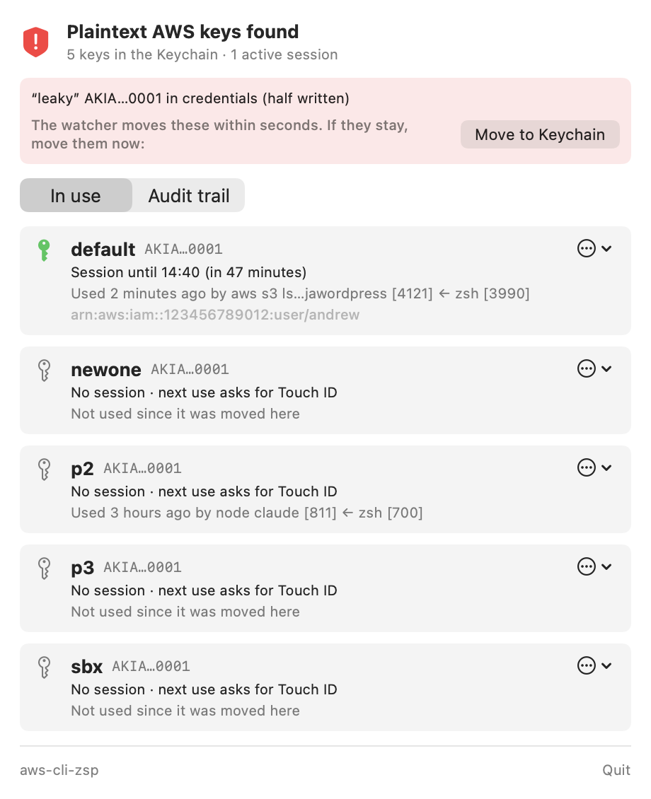
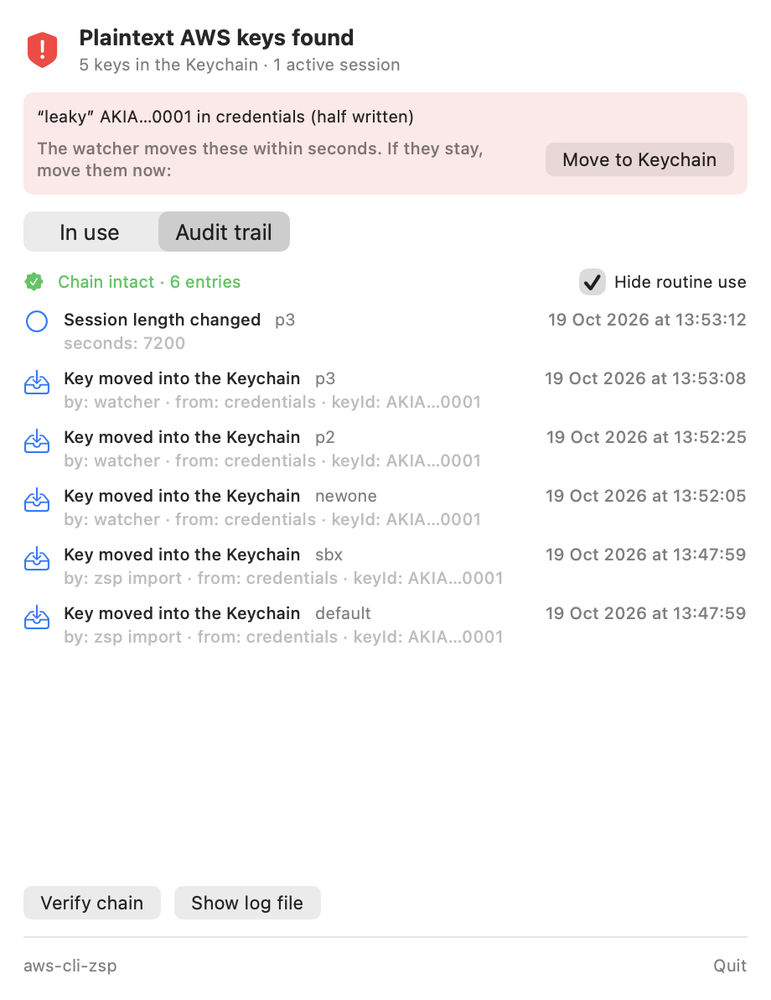

# aws-cli-zsp

**Zero standing plaintext for AWS keys on macOS.** Your access keys live in the Keychain, using
one needs Touch ID, the AWS CLI and SDKs only ever see a session that lasts an hour, and any key
that lands in `~/.aws/credentials` (from `aws configure`, a paste, a script) is moved out
within seconds.

It is built from scratch on the ideas behind [aws-vault](https://github.com/ByteNess/aws-vault),
and adds:

| | aws-vault | aws-cli-zsp |
|---|---|---|
| Keys in the Keychain, STS sessions to the CLI | ✅ | ✅ |
| Keys written to `~/.aws` are moved automatically | ❌ | ✅ launchd watcher plus a 5-minute sweep |
| Touch ID before a long-lived key is used | optional | always |
| Audit trail | ❌ | hash-chained, anchored in the Keychain, with who asked (`aws s3 ls ← zsh`) |
| Rotate a key | `aws-vault rotate` | one click, verified before the old key is deleted |
| Revoke sessions already issued (a thief's too) | ❌ | one click (an `aws:TokenIssueTime` deny policy) |
| When AWS last saw each key used | ❌ | **Check last use in AWS** |
| Menu bar UI | ❌ | ✅ |
| Works with plain `aws` and every SDK, no wrapper | `exec` or `credential_process` | `credential_process`, wired for you |

 

## Install

```bash
bash scripts/build-app.sh             # tests, build, sign, copy to ~/Applications (changes nothing in ~/.aws)
~/Applications/aws-cli-zsp.app/Contents/MacOS/zsp install
```

`zsp install`:
1. links `~/.local/bin/zsp`
2. loads `consulting.cloudscale.zsp.watch`, which runs `zsp import --auto` whenever either AWS
   file changes, and every 5 minutes
3. starts the menu bar app at login
4. moves every plaintext key into the Keychain and adds
   `credential_process = …/zsp credential-process --profile NAME` to `~/.aws/config`

From then on, `aws --profile bedrock s3 ls` works as before. The first command each hour asks
for Touch ID; the rest reuse the cached session.

## How it works

```
aws / SDK ──credential_process──▶ zsp ──cached session (≤1h)?──▶ yes: print it
                                    └──no──▶ Touch ID ──▶ Keychain: long-lived key ──▶ STS GetSessionToken
launchd WatchPaths ~/.aws/* ──▶ zsp import --auto ──▶ Keychain (read back to verify) ──▶ scrub the file
menu bar app ──reads──▶ profiles.json, audit.jsonl ;  every action ──▶ zsp (the only binary trusted by the Keychain)
```

- **One trusted binary.** The Keychain items trust zsp's code signature. Any other program
  that asks for them (`security find-generic-password -w`, malware, another app) makes macOS
  ask you first: click **Deny**. Builds are signed with a stable local identity, so rebuilding
  keeps that trust.
- **Sessions, not keys.** The CLI gets `GetSessionToken` credentials, so a leaked session expires
  on its own and cannot call IAM to mint a new key.
- **Fail closed.** A key leaves a file only after its Keychain copy has been read back. If the
  audit entry can't be written, no credentials are issued.
- **Audit chain.** `~/Library/Application Support/aws-cli-zsp/audit.jsonl`: every entry hashes
  the one before it, and the newest hash is also kept in the Keychain, so an edit, a deletion or
  a truncation fails `zsp audit --verify`.

## Commands

```
zsp list                              what is in the Keychain, sessions, last use and by whom
zsp scan                              plaintext keys left in ~/.aws (exit 1 if any)
zsp add --profile P                   type a key in, secret hidden; it never touches a file
zsp inspect --profile P               ARN, and when AWS last saw each key used
zsp rotate --profile P [--keep-old]   new key, verified, then the old one deleted (or deactivated)
zsp revoke-sessions --profile P       deny every session issued before now
zsp clear-sessions [--profile P]      drop cached sessions here (the next command needs Touch ID)
zsp duration --profile P 8h           session length, 15m to 12h (default 1h)
zsp exec --profile P -- terraform plan
zsp disable-key | delete-key | forget --profile P
zsp audit [--verify] [--limit N]
zsp uninstall [--restore-plaintext]
```

`--json` on any command prints a machine-readable result, which is what the menu bar app uses.

## Limits

- Malware running as you can run zsp too, and it gets a cached session without a prompt until
  that session expires (the same trade-off aws-vault makes). Use `clear-sessions` or a shorter
  `duration` to narrow the window. It cannot get the long-lived key.
- A Keychain item's *data* can be overwritten by another program as you (only reading it
  prompts). zsp detects a swapped key the next time you inspect or rotate it.
- Rotate, revoke and disable call IAM with the profile's own key, so the IAM user needs
  `iam:ListAccessKeys`, `iam:CreateAccessKey`, `iam:DeleteAccessKey`, `iam:UpdateAccessKey`,
  `iam:GetAccessKeyLastUsed` and `iam:PutUserPolicy` on itself.
- MFA (`mfa_serial`) is not supported yet; see PLAN.md.

## Development

```bash
swift test                               # 29 tests; the Keychain test uses a throwaway service name
ZSP_NETWORK_TESTS=1 swift test           # adds a real STS call with a fake key (expects InvalidClientTokenId)
```

To try it without touching your real setup, point it at a sandbox:
`AWS_SHARED_CREDENTIALS_FILE`, `AWS_CONFIG_FILE`, `ZSP_HOME` and `ZSP_KEYCHAIN_PREFIX`.
`ZSPMenu --snapshot out.png [--audit]` renders the panel to a file.

Always use a sandbox `ZSP_KEYCHAIN_PREFIX` with a debug build (`.build/debug/zsp`). A Keychain
item trusts the binary that created it, and a debug build has a different signature from the
installed app. The installed zsp would then hit macOS's "zsp wants to use your confidential
information" *password* dialog, where Touch ID is not offered, for any item the debug build
made. The audit anchor check never shows that dialog, but reading a key does, by design.
